<div align="center">

# 🏃 SprintScrum · AgendaFácil

**Planeación de un sprint Scrum de una semana, convertida en un portal interactivo y verificable**

      

**[🌐 Portal en vivo](https://sprintscrum.iagentek.com.mx)** · **[🎬 Video del recorrido](docs/readme/recorrido.mp4)** · **[📦 Entregables](https://sprintscrum.iagentek.com.mx/entregables)** · **[🛡️ Cumplimiento](https://sprintscrum.iagentek.com.mx/cumplimiento)**

*UNIR México · Maestría en Inteligencia Artificial · Metodología de Diseño y Gestión de Proyectos · Actividad 1 grupal*
*Equipo 2073 F · Profesora: Adriana Cervantes Castillo · Octubre de 2026*


</div>

## ✨ En una mirada

| Product backlog | Sprint | Sprint backlog | Equipo | Llegar a la review | Rúbrica |
|---|---|---|---|---|---|
| 📚 **8** historias · **50** pts | 🎯 **3** historias · **16** pts | 🧩 **15** tareas · **51** h | 👥 **4** personas · **5** días | 📉 **≈ 50 %** (simulación) | ✅ **16/17** + 1 aviso |

## 🧭 Contenido

- [Qué es](#-qué-es)
- [Cómo cubre la rúbrica](#-cómo-cubre-la-rúbrica)
- [Recorrido por el portal](#-recorrido-por-el-portal)
- [Lo interactivo](#-lo-interactivo)
- [En el celular](#-en-el-celular)
- [Arquitectura](#️-arquitectura)
- [Metodología](#-metodología)
- [Estructura del repositorio](#-estructura-del-repositorio)
- [Reproducir](#️-reproducir)

## 📌 Qué es

La actividad pide **simular la planeación de un sprint Scrum de una semana** y explicar qué haría cada integrante desde
su rol. El equipo eligió **AgendaFácil**, una aplicación web de citas que la consultora *Nexo Digital Solutions* desarrolla
para la *Clínica Dental Sonrisa Plena* (empresa y cliente ficticios), con el objetivo de bajar las inasistencias del
25 % a menos del 10 %.

Hay **dos capas**: el sprint de AgendaFácil **se planea, no se ejecuta** (es el contenido de la actividad); este portal
**sí se construyó y está en producción**, y presenta esa planeación de forma interactiva y comprobable.

| Integrante | Rol Scrum | Horas en el sprint |
|---|---|---|
| Adonai Samael Hernández Mata | Product owner | 4 h |
| Cesar Ivan Martinez Perez | Scrum master y desarrollador (pruebas) | 8 h |
| Mauricio Alberto Alvarez Aspeitia | Desarrollador (backend) | 23 h |
| Diego Alfonso Nájera Ortiz | Desarrollador (frontend) | 16 h |

> [!NOTE]
> **Una sola fuente de verdad.** Todo el texto académico sale de `fuente/contenido.py`, el mismo archivo que genera el
> documento entregado (.docx y .pdf). El portal se alimenta de ahí, así que **no puede decir algo distinto del documento**.
> Lo que el portal agrega (día de cada tarea, dependencias, hora de los eventos y criterios de aceptación) está en
> `scripts/plan_sprint.py` y se rotula como ampliación.

## ✅ Cómo cubre la rúbrica

Cada requisito se **comprueba en el servidor** contra la base de datos y el .docx entregado (conteos de palabras, formato
de las historias, tareas completas, fuente e interlineado). Nada se marca a mano: [ver cumplimiento en vivo](https://sprintscrum.iagentek.com.mx/cumplimiento).

| Criterio (20 % c/u) | Qué pide | Evidencia |
|---|---|---|
| **1. Descripción del proyecto** | Empresa, cliente y objetivos; ≤ 150 palabras | 125 palabras · [/proyecto](https://sprintscrum.iagentek.com.mx/proyecto) |
| **Roles Scrum** | PO, SM y ≥ 2 desarrolladores; cada persona con rol | 4 de 4 · [/equipo](https://sprintscrum.iagentek.com.mx/equipo) |
| **2. Product backlog** | ≥ 5 historias con prioridad y estimación | 8 historias «Como… quiero… para…», Fibonacci · [/product-backlog](https://sprintscrum.iagentek.com.mx/product-backlog) |
| **3. Sprint backlog** | 3 historias en tareas con responsable y tiempo | 15 tareas, 51 h · [/sprint-backlog](https://sprintscrum.iagentek.com.mx/sprint-backlog) |
| **4. Reflexión individual** | 150–200 palabras: tareas, retos y contribución | 172 · 164 · 167 · 166 palabras · [/reflexiones](https://sprintscrum.iagentek.com.mx/reflexiones) |
| **5. Conclusión grupal** | ≤ 200 palabras | 183 palabras · [/conclusion](https://sprintscrum.iagentek.com.mx/conclusion) |
| **Formato** | Calibri 12, interlineado 1,5 | En todo el documento, tablas y títulos incluidos |

> [!IMPORTANT]
> El único aviso es la **extensión**: el enunciado pide un máximo de 500 palabras, pero solo las cuatro reflexiones
> obligatorias ya suman ~670. Es una contradicción del propio enunciado, por confirmar con la profesora.

## 🗺️ Recorrido por el portal

<table>
<tr>
<td width="50%">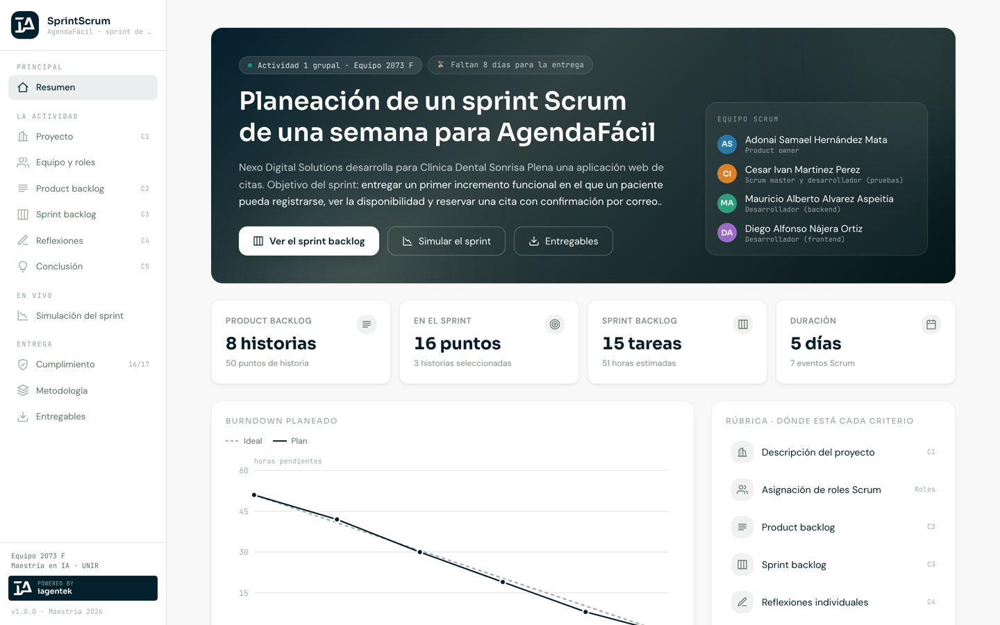<br><sub><b>Resumen</b> · objetivo del sprint, equipo, cifras, burndown y cuenta regresiva a la entrega</sub></td>
<td width="50%">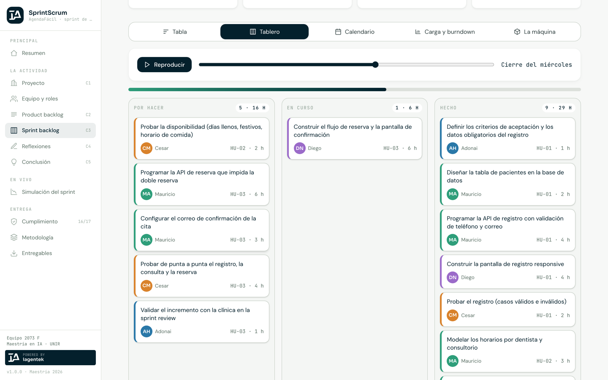<br><sub><b>Sprint backlog</b> · tablero Kanban que recorre la semana; las tarjetas vuelan de columna</sub></td>
</tr>
<tr>
<td>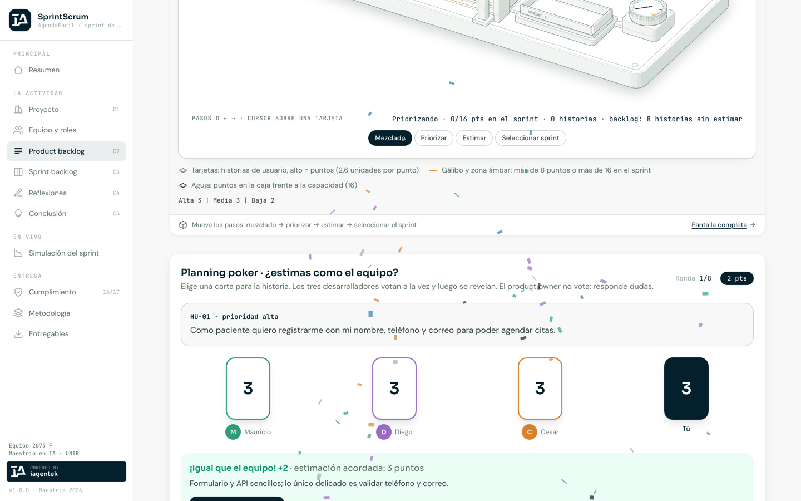<br><sub><b>Planning poker</b> · estima cada historia y compara con el equipo</sub></td>
<td>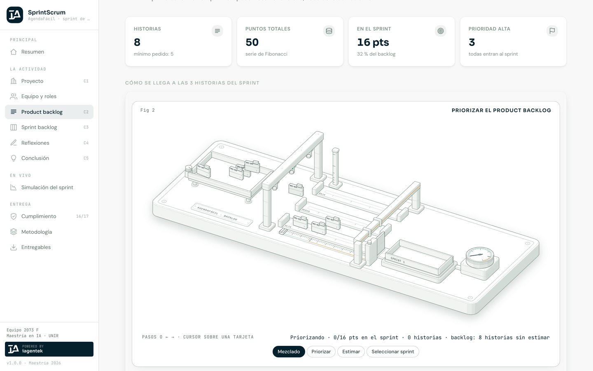<br><sub><b>Product backlog</b> · máquina que prioriza, estima y selecciona las 3 historias del sprint</sub></td>
</tr>
<tr>
<td>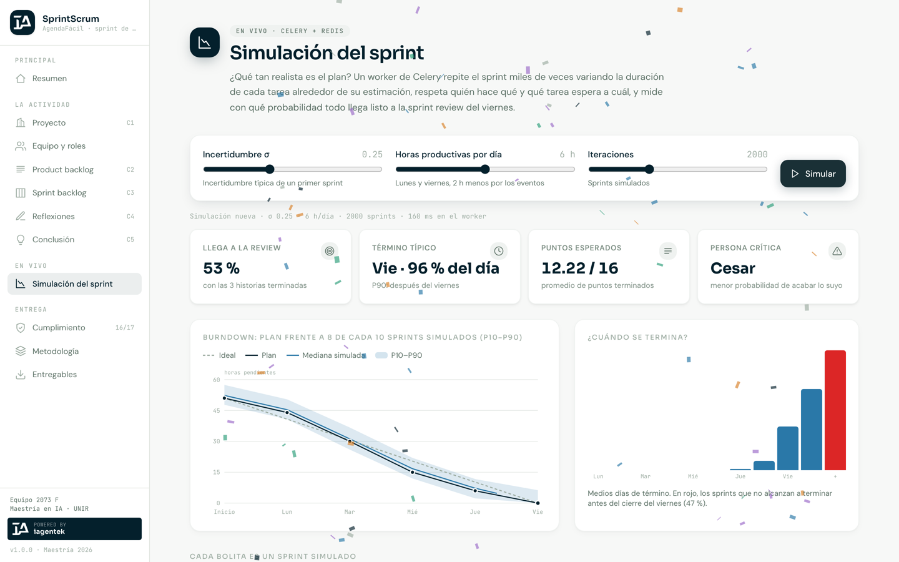<br><sub><b>Simulación</b> · Monte Carlo del sprint: probabilidad de llegar a la review y burndown P10–P90</sub></td>
<td>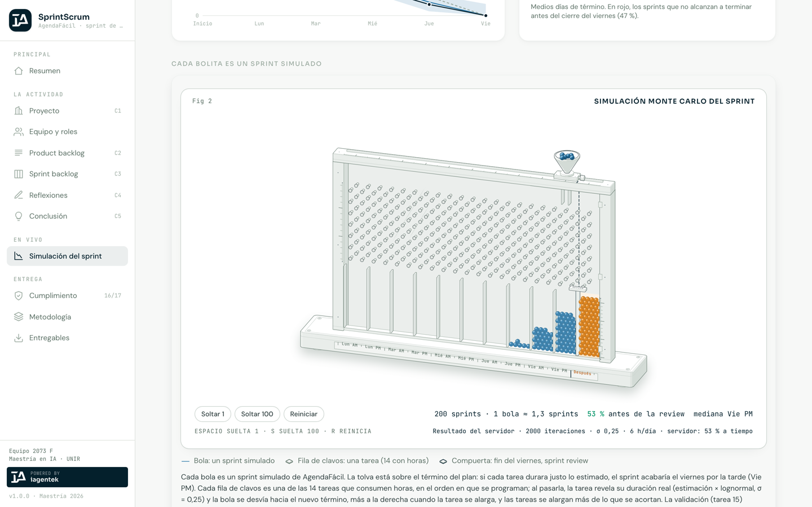<br><sub><b>Tablero de Galton</b> · cada bolita es un sprint simulado; se apilan en el día en que termina</sub></td>
</tr>
<tr>
<td>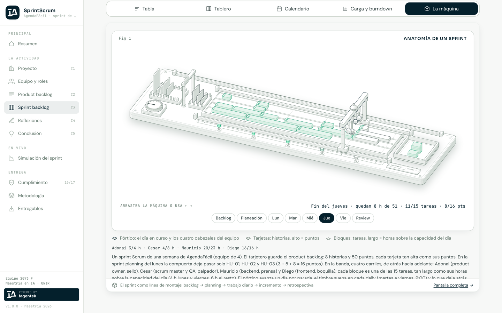<br><sub><b>La máquina del sprint</b> · backlog → planning → lunes a viernes → incremento → retrospectiva</sub></td>
<td>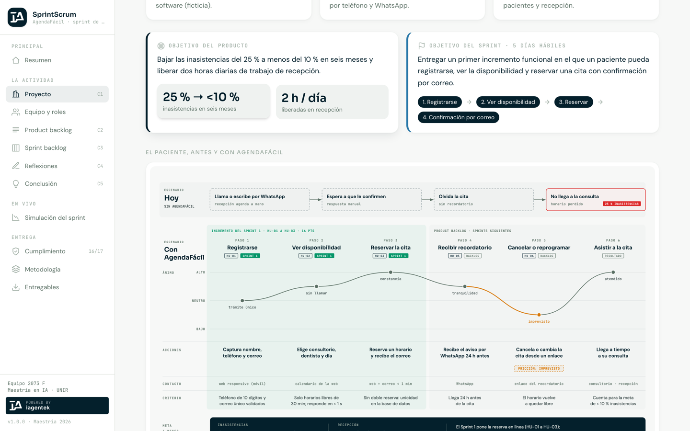<br><sub><b>Proyecto</b> · el paciente antes y con AgendaFácil, y la vida de una cita</sub></td>
</tr>
<tr>
<td>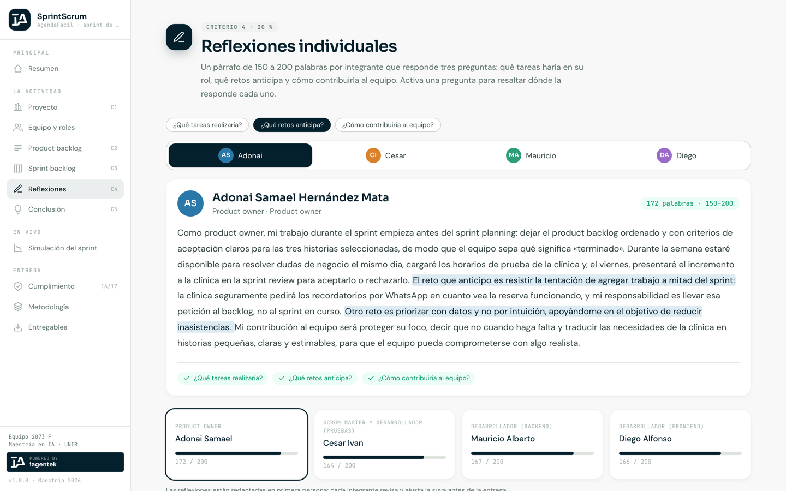<br><sub><b>Reflexiones</b> · resalta dónde responde cada integrante las tres preguntas del enunciado</sub></td>
<td>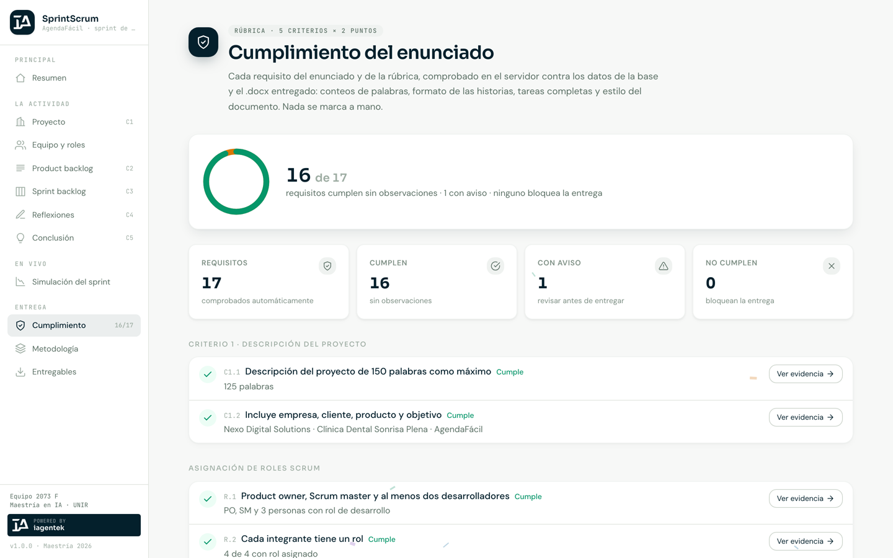<br><sub><b>Cumplimiento</b> · 17 requisitos comprobados contra los datos y el .docx</sub></td>
</tr>
</table>

<details>
<summary><b>🎬 Video completo del recorrido (MP4)</b></summary>

[docs/readme/recorrido.mp4](docs/readme/recorrido.mp4) — resumen, proyecto, planning poker, Kanban animado, la máquina
del sprint, simulación con el tablero de Galton, cumplimiento y entregables.

</details>

## 🎮 Lo interactivo

| Qué | Dónde | Cómo funciona |
|---|---|---|
| **Planning poker** | Product backlog | Eliges una carta (1–13) por historia; los tres desarrolladores votan, las cartas giran y se explica la estimación acordada. El product owner no vota. Puntaje y mejor marca |
| **Kanban que recorre la semana** | Sprint backlog | Al mover el día, las tarjetas vuelan a *Por hacer / En curso / Hecho*; barra de progreso y celebración al cerrar el viernes con 15/15 |
| **Simulación Monte Carlo** | Simulación | Un worker repite el sprint miles de veces con duraciones `estimación × LogNormal(0, σ)`, respetando quién hace qué y qué tarea espera a cuál. Resultado: probabilidad de llegar a la review, término P10/P50/P90, persona crítica |
| **Tablero de Galton** | Simulación | Recibe el resultado real del servidor y deja caer las bolitas para dibujar ese histograma |
| **Figuras isométricas** | Resumen · Backlog · Sprint | Máquinas que explican el sprint y la priorización; se manejan con botones, teclado o arrastrando |
| **Diagramas** | Todas las páginas | Arquitectura, Gantt, mapa del backlog, organigrama, secuencia, ciclo Scrum, recorrido del paciente y estados de una cita; se amplían al hacer clic |

Todas las animaciones (transiciones entre páginas, gráficas que se dibujan, aparición al hacer scroll) usan la API nativa
de View Transitions y CSS, y **se desactivan si el sistema pide reducir el movimiento**.

> **Hallazgo de la simulación:** si todo dura lo estimado, el plan termina el viernes con holgura; con una incertidumbre
> típica de primer sprint (σ = 0.25) la probabilidad de llegar con las tres historias a la review es de ~50 %. La persona
> crítica es quien prueba al final de la cadena, porque absorbe los retrasos de los demás: justo lo que el equipo propone
> mitigar probando cada historia en cuanto está lista.

## 📱 En el celular

<p align="center">
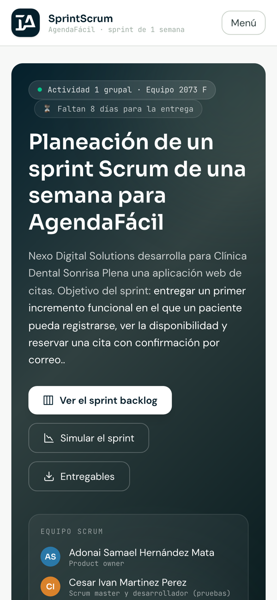&nbsp;
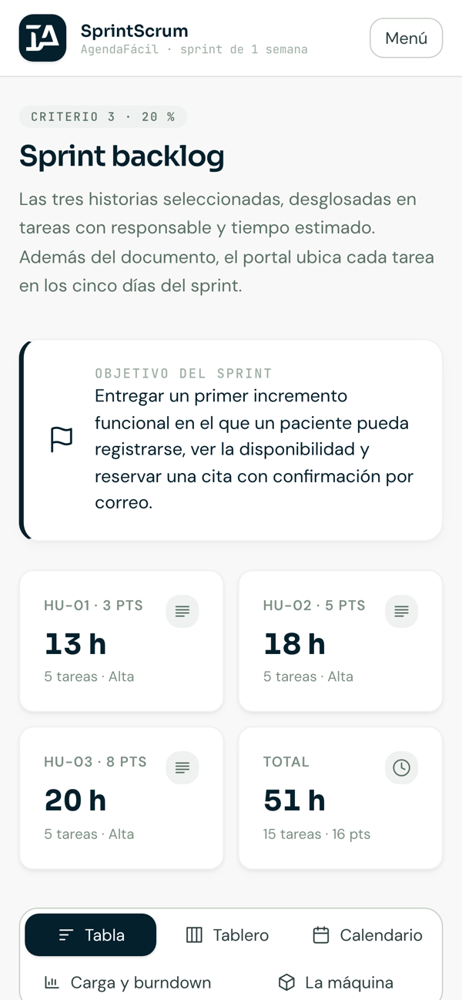&nbsp;
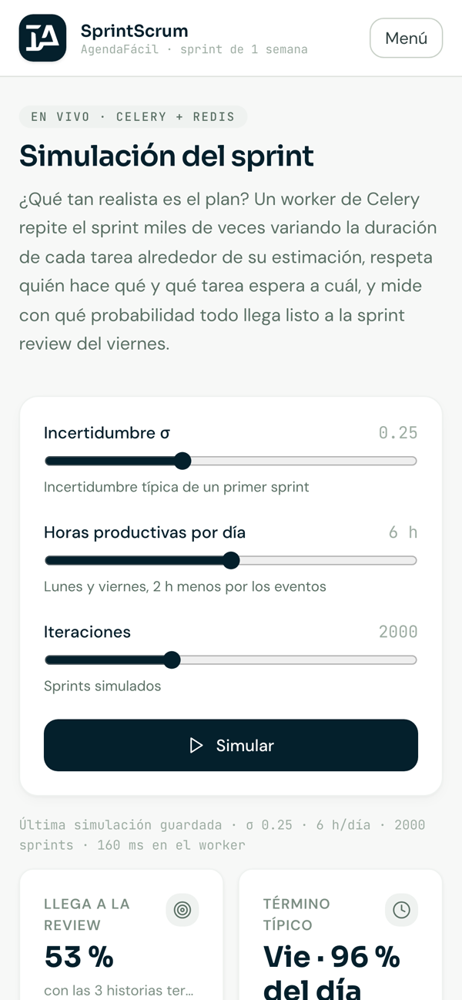
</p>

## 🏗️ Arquitectura

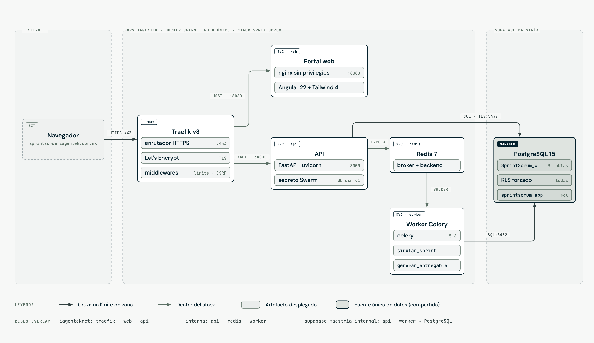

| Capa | Tecnología |
|---|---|
| **Frontend** | Angular 22 (standalone, signals, `httpResource`, View Transitions) · Tailwind CSS 4 · Forest Design System · nginx sin privilegios |
| **API** | Python 3.11 · FastAPI · psycopg 3 |
| **Trabajos** | Celery 5.6 con Redis 7: `simular_sprint` y `generar_entregable` (ZIP con manifiesto SHA-256) |
| **Datos** | Supabase (PostgreSQL 15): tablas `SprintScrum_*` con seguridad por filas y un rol propio de la aplicación |
| **Despliegue** | Docker Swarm, Traefik v3 con Let's Encrypt, imágenes etiquetadas con el commit |

**Seguridad:** política de contenido (CSP) estricta, HSTS, protección contra incrustación, límites de peticiones por IP
(más estrictos para escrituras), cabecera anti-CSRF propia en las acciones que escriben, descargas solo de archivos
registrados en el catálogo, sin documentación interactiva de la API en producción, credenciales como secretos de
Docker Swarm y ninguna tabla accesible para usuarios anónimos. Los datos del servidor no viven en este repositorio.

## 🧪 Metodología

El portal se construyó con **desarrollo guiado por especificaciones** y el **método BMAD** de planeación ágil:

1. **GitHub spec-kit** — constitución → especificación → plan → contratos → tareas, en
   [`specs/001-portal-sprintscrum/`](specs/001-portal-sprintscrum/) y [`.specify/memory/constitution.md`](.specify/memory/constitution.md).
2. **Método BMAD** — product brief, PRD, arquitectura, épicas e historias y estado del sprint, en [`_bmad-output/`](_bmad-output/).
3. **Figuras y diagramas** — tres figuras isométricas interactivas y ocho diagramas con la identidad visual del portal, en [`docs/figuras/`](docs/figuras/).

<p align="center">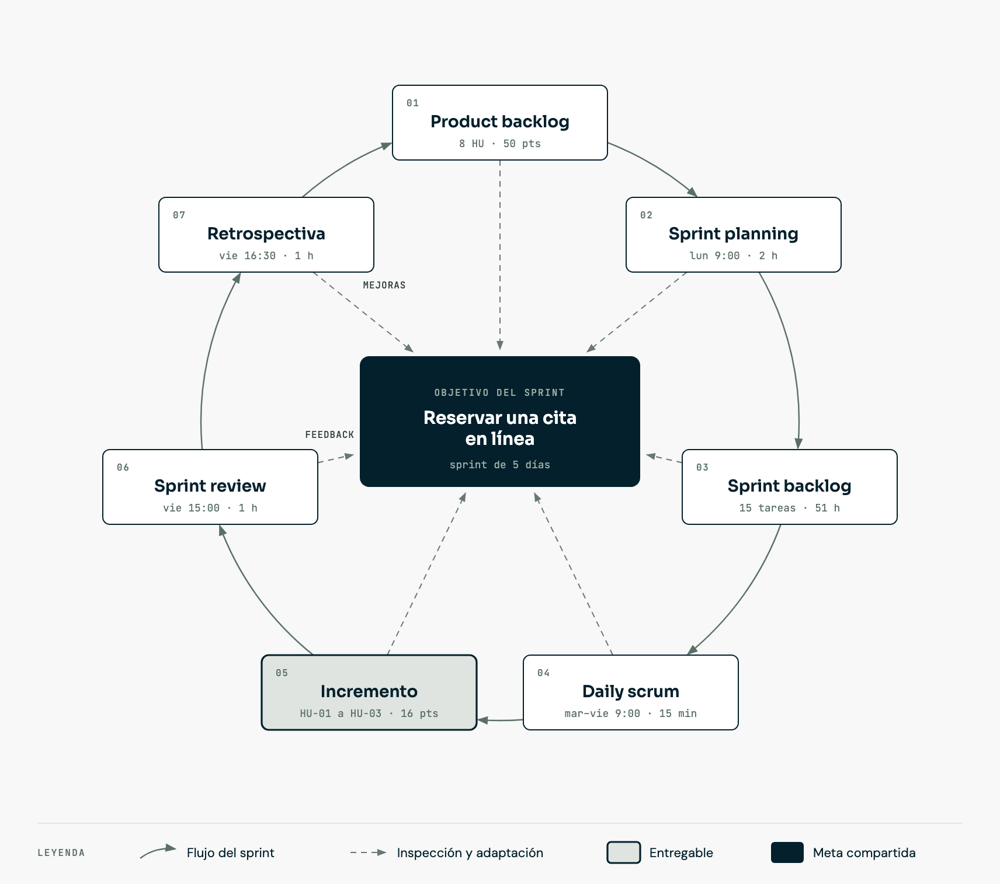</p>

## 📁 Estructura del repositorio

```
├── backend/            API FastAPI, tareas de Celery, simulación Monte Carlo y pruebas
├── frontend/           Portal Angular 22 + Tailwind 4 (páginas, componentes, animaciones)
├── db/                 Migraciones de Supabase (esquema, seguridad, contenido) y catálogo
├── scripts/            Semilla desde fuente/contenido.py, plan del sprint y entregables
├── fuente/             contenido.py — el texto de la actividad (copia sincronizada)
├── entregables/        Documento .docx/.pdf, ZIP para Moodle, CSV, figuras y especificaciones
├── docs/               Diseño, figuras isométricas, diagramas y material de este README
├── specs/              Especificación (spec-kit)
├── _bmad-output/       Planeación (método BMAD)
└── deploy/             Stack de Docker Swarm y script de despliegue
```

## 🛠️ Reproducir

```bash
# Backend: pruebas de la simulación
cd backend && python3.11 -m venv .venv && .venv/bin/pip install -r requirements.txt pytest && .venv/bin/python -m pytest -q

# Frontend contra la API pública
cd frontend && npm ci && npx ng serve        # http://localhost:4200

# Contenido y entregables desde fuente/contenido.py
python3 scripts/generar_semilla.py && python3 scripts/preparar_entregables.py

# Despliegue: requiere deploy/.env.deploy (plantilla en deploy/.env.deploy.ejemplo, fuera del repositorio)
./deploy/deploy.sh
```

<div align="center">
<sub>Equipo 2073 F · UNIR México · Metodología de Diseño y Gestión de Proyectos · 2026</sub>
</div>
