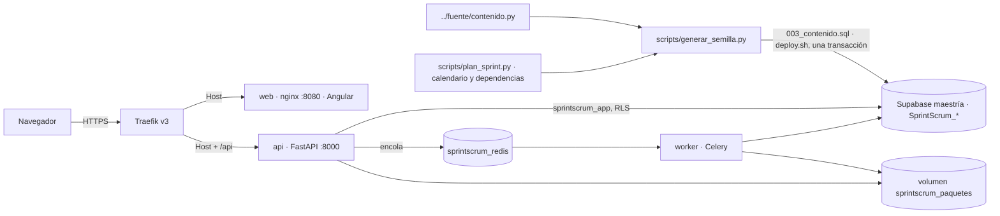
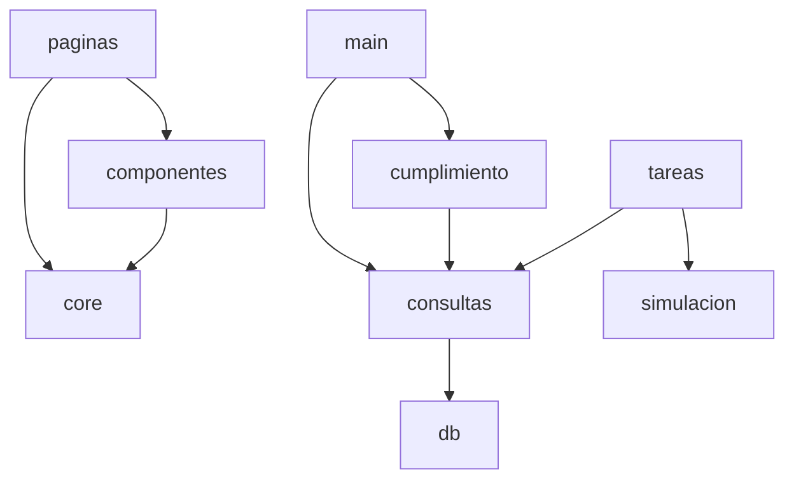
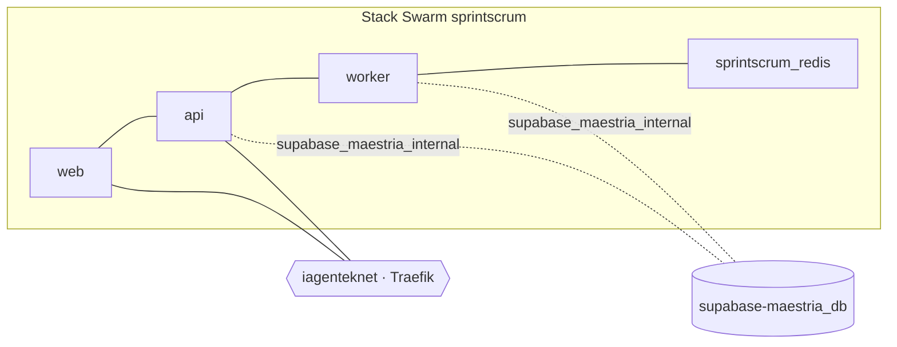

# Architecture Spine — SprintScrum · AgendaFácil

> La planificación detallada vive en spec-kit (`specs/001-portal-sprintscrum/`). Este documento fija
> solo las reglas que mantienen coherentes las piezas. Describe el **portal** (capa B); el sprint de
> AgendaFácil (capa A) es solo datos.

## Design Paradigm



Capas del backend: `main.py` (HTTP) → `consultas.py` (SQL y derivados) / `cumplimiento.py` /
`simulacion.py` (función pura) → `db.py`. `simulacion.py` no toca la base.

## Invariants & Rules

### AD-1 — `contenido.py` es la única fuente del texto [ADOPTED]
- **Binds:** FR-001, FR-008, SC-001
- **Prevents:** que el portal y el .pdf digan cosas distintas.
- **Rule:** el texto académico entra solo por `scripts/generar_semilla.py`; el frontend no contiene texto
  académico; todo complemento (de `scripts/plan_sprint.py`) lleva el rótulo «ampliación del portal» en la UI.

### AD-2 — Cifras calculadas en la API [ADOPTED]
- **Binds:** FR-010–FR-012, SC-002, SC-003
- **Prevents:** totales escritos a mano que se desactualizan.
- **Rule:** palabras, totales, carga, burndown y cumplimiento salen de `consultas.py` y `cumplimiento.py`
  en cada petición; no se guardan en tablas ni se escriben en el frontend. El conteo usa la regex de
  `fuente/construir.py`.

### AD-3 — Dos capas de Scrum separadas [ADOPTED]
- **Binds:** FR-009, FR-019
- **Prevents:** presentar el sprint de AgendaFácil como ejecutado o mezclar sus ids con los del portal.
- **Rule:** ids de capa A (`HU-xx`, tareas 1–15) solo en datos; ids de capa B (`US`, `FR`, `T`, épicas) solo
  en artefactos de planificación. El Resumen y el sprint backlog rotulan el sprint como planeado.

### AD-4 — Aislamiento de datos [ADOPTED]
- **Binds:** FR-021, SC-007
- **Rule:** tablas `public."SprintScrum_<tabla>"`; RLS habilitado y forzado; `anon`/`authenticated` sin
  privilegios; única política para `sprintscrum_app`; la API solo lee contenido y solo escribe en
  `simulaciones` y `paquetes`. DSN en el secreto `sprintscrum_db_dsn_v1`.

### AD-5 — Trabajo pesado fuera de la API [ADOPTED]
- **Binds:** FR-014, FR-018, SC-004
- **Rule:** simulación y ZIP solo como tareas Celery (`sprintscrum.simular_sprint`,
  `sprintscrum.generar_entregable`). La API inserta la fila, encola y responde 202; la fila en Postgres es
  la fuente del estado.

### AD-6 — Seguridad en el borde [ADOPTED]
- **Binds:** FR-021
- **Rule:** HSTS, cabeceras de la API, límite de tasa (20/s ráfaga 60; `POST` 20/min ráfaga 10) y de
  cuerpo (8192 bytes) como middlewares de Traefik; CSP y demás cabeceras del SPA en nginx; la API valida
  rangos y la cabecera `X-Requested-With: portal-sprintscrum`. Contenedores sin root.

### AD-7 — Despliegue por sha [ADOPTED]
- **Binds:** SC-008
- **Rule:** imágenes `:<sha corto>` (sufijo `-dirty` si hay cambios sin commit); solo `deploy/deploy.sh`
  despliega y verifica; el stack nunca usa `:latest`.

### AD-8 — Redis con nombre de servicio completo [ADOPTED]
- **Binds:** FR-014, FR-018, FR-024
- **Prevents:** que la API o el worker hablen con el Redis de otro stack.
- **Rule:** se direcciona como `sprintscrum_redis`; en una red overlay compartida el nombre corto `redis`
  puede resolver al servicio de otro stack, por eso se usa el nombre calificado.

### AD-9 — Movimiento nativo y figuras del mismo origen [ADOPTED]
- **Binds:** FR-025–FR-030, SC-009, SC-010 (US7, ampliación posterior)
- **Prevents:** dependencias de animación, mareo en usuarios sensibles al movimiento e incrustar URLs
  arbitrarias.
- **Rule:** el movimiento usa la View Transitions API (`withViewTransitions()` en `app.config.ts`,
  `conTransicion()` en `core/movimiento.ts`) y CSS de `styles.css`; sin biblioteca de animación. Todo se
  anula con `prefers-reduced-motion: reduce` (`sinMovimiento()`). Las figuras isométricas interactivas se incrustan con
  `componentes/figura.ts` solo como `/figuras/<carpeta>/index.html` (carpeta `^[a-z][a-z-]*$`) y
  `postMessage` a `location.origin`; nginx permite `frame-ancestors 'self'` solo en `/figuras/`.



## Consistency Conventions

| Concern | Convention |
| --- | --- |
| Naming | Español, `snake_case` en Python y SQL, un archivo `.ts` por página o componente en Angular; tablas `SprintScrum_<plural>` |
| Días | entero `1 = lunes … 5 = viernes`; etiquetas «Lun…Vie» solo en la UI |
| Horas | `numeric(4,1)` en BD, número con un decimal en JSON |
| Errores | `{"detail": "<mensaje en español>"}` + código HTTP; la UI lo muestra tal cual |
| Estados de trabajos | `pendiente` → `completada` \| `error` |
| Complementos | rótulo «ampliación del portal» en la UI |
| Frontend | standalone, signals, `httpResource`; un componente `estado` para carga/vacío/error; movimiento con View Transitions + CSS, anulado con `prefers-reduced-motion`; confeti (`componentes/confeti.ts`) y aparición al desplazar (`componentes/revelar.ts`) sin dependencias; figuras por `componentes/figura.ts` (iframe mismo origen) y diagramas por `componentes/diagrama.ts` (`indice.json`) |
| Configuración | DSN en `/run/secrets/sprintscrum_db_dsn` (`DATABASE_URL_FILE`); en local `DATABASE_URL`, `REDIS_URL`, `REDIS_RESULT_URL` |

## Stack

| Name | Version |
| --- | --- |
| Python | 3.11 |
| FastAPI + Uvicorn | 0.141 + 0.54 |
| psycopg | 3.x (con `psycopg_pool`) |
| Celery | 5.6 |
| Redis | 7 |
| PostgreSQL (Supabase maestría) | 15 |
| Angular | 22 |
| Tailwind CSS | 4 |
| Traefik | v3 |
| Docker Swarm | nodo único iaGentek |

## Structural Seed

```text
dev/                       # repo github.com/azulls1/sprintscrum, dentro de «Actividad 1 grupal/»
  backend/app/        # main, config, db, consultas, cumplimiento, simulacion, celery_app, tareas
  backend/tests/      # test_simulacion.py, datos_sprint.py
  frontend/src/app/   # paginas/ (11), componentes/ (incl. planning-poker, figura, diagrama, confeti, revelar), core/ (incl. movimiento)
  db/migraciones/     # 001_esquema.sql, 002_seguridad.sql, 003_contenido.sql (generada)
  scripts/            # plan_sprint.py, generar_semilla.py, preparar_entregables.py
  fuente/             # copia de ../fuente/contenido.py
  deploy/             # stack.yml, deploy.sh
  docs/               # DISENO.md, figuras/ (anatomia, anatomia-backlog, anatomia-galton, diagramas/)
  specs/              # spec-kit (capa B)
  _bmad-output/       # BMAD (capa B)
```



## Capability → Architecture Map

| Capability / Area | Lives in | Governed by |
| --- | --- | --- |
| Contenido C1–C5 (FR-001–FR-007) | `scripts/`, `main.py` (`/proyecto`, `/equipo`, `/backlog`, `/reflexiones`, `/conclusion`), `paginas/*` | AD-1, AD-2 |
| Cumplimiento y KPI (FR-010–FR-012) | `consultas.py`, `cumplimiento.py`, `/resumen`, `/cumplimiento` | AD-2 |
| Sprint backlog (FR-005, FR-006) | `/sprint`, `paginas/sprint.ts` (tabla, tablero, calendario, carga), `componentes/burndown.ts` | AD-2, AD-3 |
| Simulación (FR-013–FR-016) | `simulacion.py`, `tareas.py`, `paginas/simulacion.ts` | AD-5, AD-8 |
| Entregables (FR-017, FR-018) | `scripts/preparar_entregables.py`, `/entregables`, `tareas.py`, volumen | AD-5 |
| Seguridad (FR-021, SC-007) | `002_seguridad.sql`, `main.py`, labels Traefik, `frontend/seguridad-headers.conf` | AD-4, AD-6 |
| Despliegue (SC-008) | `deploy/` | AD-7, AD-8 |
| Experiencia interactiva (FR-025–FR-030) | `componentes/planning-poker.ts`, `figura.ts`, `diagrama.ts`, `confeti.ts`, `revelar.ts`, `core/movimiento.ts`, `styles.css`, `docs/figuras/` | AD-9 |

## Deferred

- Autenticación y edición en línea: no hay escrituras de contenido; se reabre solo si el portal se vuelve
  multi-actividad.
- Caché de lecturas: ~40 filas y < 100 ms; no hace falta.
- Observabilidad más allá de `/health` y logs de Swarm: uso de demostración.
