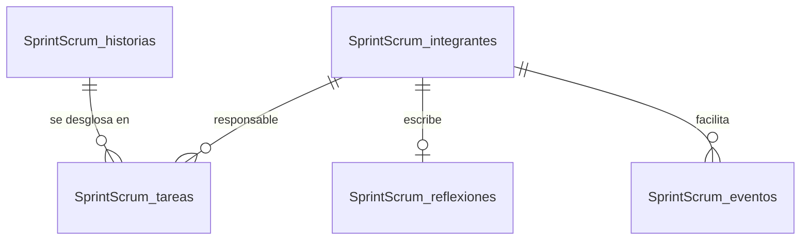

# Data Model — Fase 1

PostgreSQL 15 de Supabase maestría, esquema `public`. Nueve tablas con prefijo `SprintScrum_` (los
nombres se citan entre comillas dobles por la mayúscula). Migraciones: `db/migraciones/001_esquema.sql`,
`002_seguridad.sql` y `003_contenido.sql` (generada), más `db/catalogo_entregables.sql` (generado).

**Quién escribe**: las tablas de **contenido** (1–6) las llena `003_contenido.sql`, que genera
`scripts/generar_semilla.py`, y la 8 la llena `db/catalogo_entregables.sql`, que genera
`scripts/preparar_entregables.py`; `deploy.sh` aplica ambos con el administrador de la base. La API
solo las lee. `simulaciones` y `paquetes` las
escribe la API (insertar) y el worker (actualizar).

**Lo que no se guarda**: conteos de palabras, totales, carga, burndown y cumplimiento se calculan en la
API (principio II). No se guardan IP ni datos de visitantes.



## 1. `SprintScrum_proyecto` — una sola fila

| Columna | Tipo | Restricciones / origen |
|---|---|---|
| `id` | text | PK · `'agendafacil'` |
| `empresa` | text | not null · «Nexo Digital Solutions» (extraído de `DESCRIPCION[0]`) |
| `cliente` | text | not null · «Clínica Dental Sonrisa Plena» |
| `producto` | text | not null · «AgendaFácil» |
| `objetivo_producto` | text | not null · `DESCRIPCION[2]` |
| `objetivo_sprint` | text | not null · `DESCRIPCION[3]` |
| `descripcion` | jsonb | not null · los 4 párrafos de `DESCRIPCION` tal cual |
| `portada` | jsonb | not null · `PORTADA` (universidad, programa, asignatura, equipo, profesora, fecha) |
| `duracion_dias` | smallint | not null, `check (duracion_dias between 1 and 30)` · 5 |
| `nota_backlog` | text | not null · `NOTA_BACKLOG` |
| `nota_sprint` | text | not null · `NOTA_SPRINT` |
| `conclusion` | text | not null · `CONCLUSION` |
| `actualizado_en` | timestamptz | not null, `default now()` |

## 2. `SprintScrum_integrantes`

| Columna | Tipo | Restricciones / origen |
|---|---|---|
| `id` | smallint | PK |
| `nombre` | text | not null, unique · `ROLES[i][1]` |
| `nombre_corto` | text | not null, unique · primer nombre + primer apellido: «Adonai Hernández», «Cesar Martinez», «Mauricio Alvarez», «Diego Nájera» |
| `rol` | text | not null · texto del documento, p. ej. «Scrum master y desarrollador (pruebas)» |
| `rol_scrum` | text | not null, `check (rol_scrum in ('product_owner','scrum_master','developer'))` · `ROL_SCRUM` de `plan_sprint.py` |
| `responsabilidad` | text | not null · `ROLES[i][2]` |
| `orden` | smallint | not null |

## 3. `SprintScrum_historias`

| Columna | Tipo | Restricciones / origen |
|---|---|---|
| `id` | text | PK, `check (id ~ '^HU-[0-9]{2}$')` |
| `orden` | smallint | not null, unique |
| `texto` | text | not null (el formato «Como… quiero… para…» lo comprueba `cumplimiento.py`, C2.2) |
| `prioridad` | text | not null, `check (prioridad in ('Alta','Media','Baja'))` |
| `puntos` | smallint | not null, `check (puntos in (1,2,3,5,8,13,21))` |
| `en_sprint` | boolean | not null, `default false` · true para HU-01…HU-03 (derivado de `SPRINT_BACKLOG`) |
| `criterios` | jsonb | not null, `default '[]'` · `CRITERIOS` de `plan_sprint.py` · **complemento del portal** (no está en el documento) |

## 4. `SprintScrum_tareas`

| Columna | Tipo | Restricciones / origen |
|---|---|---|
| `id` | smallint | PK · número de la tarea (1–15) |
| `historia_id` | text | not null, FK → `historias(id)` `on delete cascade` |
| `nombre` | text | not null · texto completo de `SPRINT_BACKLOG` |
| `responsable_id` | smallint | not null, FK → `integrantes(id)` |
| `horas` | numeric(4,1) | not null, `check (horas > 0)` |
| `dia_inicio` | smallint | not null, `check (dia_inicio between 1 and 5)` · **complemento del portal** (`CALENDARIO_TAREAS`) |
| `dia_fin` | smallint | not null, `check (dia_fin between 1 and 5)`, `check (dia_fin >= dia_inicio)` · **complemento del portal** |
| `tipo` | text | not null, `check (tipo in ('analisis','backend','frontend','pruebas','validacion'))` · lo usa la simulación (`validacion` ocurre en la review) |
| `depende_de` | smallint[] | not null, `default '{}'` · precedencias explícitas (`DEPENDENCIAS` de `plan_sprint.py`) · **complemento del portal** |

Índice: `(historia_id)`.

## 5. `SprintScrum_eventos` — complemento del portal

| Columna | Tipo | Restricciones |
|---|---|---|
| `id` | smallint | PK |
| `nombre` | text | not null · «Sprint planning», «Daily scrum», «Sprint review», «Retrospectiva» |
| `dia` | smallint | not null, `check (dia between 1 and 5)` |
| `hora` | time | not null |
| `duracion_min` | smallint | not null, `check (duracion_min > 0)` |
| `facilitador_id` | smallint | not null, FK → `integrantes(id)` |
| `descripcion` | text | not null |

Filas (`EVENTOS` de `plan_sprint.py`): planning lun 9:00 120 min (Cesar); daily mar–vie 9:00 15 min (Cesar);
review vie 15:00 60 min (Adonai); retrospectiva vie 16:30 60 min (Cesar) → 7 filas.

## 6. `SprintScrum_reflexiones`

| Columna | Tipo | Restricciones / origen |
|---|---|---|
| `integrante_id` | smallint | PK, FK → `integrantes(id)` `on delete cascade` |
| `titulo` | text | not null · `REFLEXIONES[i][0]` |
| `texto` | text | not null · `REFLEXIONES[i][1]` |

## 7. `SprintScrum_simulaciones`

| Columna | Tipo | Restricciones |
|---|---|---|
| `id` | uuid | PK, `default gen_random_uuid()` |
| `task_id` | text | null · id de Celery |
| `estado` | text | not null, `default 'pendiente'`, `check (estado in ('pendiente','completada','error'))` |
| `parametros` | jsonb | not null · `{iteraciones, variabilidad, capacidad_horas_dia, semilla}` (rangos validados por Pydantic en la API) |
| `resultado` | jsonb | null · salida de `simulacion.simular()`, ver `contracts/api.md` |
| `error` | text | null |
| `duracion_ms` | int | null |
| `creado_en` | timestamptz | not null, `default now()` |
| `completado_en` | timestamptz | null |

Índice `(creado_en desc)` para `/simulacion/ultima`. El worker conserva las 200 más recientes.

## 8. `SprintScrum_entregables`

| Columna | Tipo | Restricciones |
|---|---|---|
| `ruta` | text | PK · relativa a `/app/entregables` en la imagen `api` |
| `nombre` | text | not null |
| `tipo` | text | not null · Documento, PDF, Paquete, Datos, Figura, Especificación, BMAD |
| `criterio` | text | not null · Entrega, C2, C3, Roles, Figuras, spec-kit, BMAD |
| `detalle` | text | not null, `default ''` |
| `bytes` | bigint | not null |
| `sha256` | text | not null, `check (length(sha256) = 64)` |
| `orden` | smallint | not null, `default 0` |

`scripts/preparar_entregables.py` recalcula `bytes` y `sha256` de cada archivo en cada despliegue (dato
medido, no escrito).

## 9. `SprintScrum_paquetes`

| Columna | Tipo | Restricciones |
|---|---|---|
| `id` | uuid | PK, `default gen_random_uuid()` |
| `task_id` | text | null |
| `estado` | text | not null, `default 'pendiente'`, `check (estado in ('pendiente','completada','error'))` |
| `archivo` | text | null · nombre del ZIP en el volumen `sprintscrum_paquetes` |
| `n_archivos` | int | null · archivos del catálogo + `MANIFIESTO_SHA256.txt` |
| `bytes` | bigint | null |
| `sha256` | text | null |
| `error` | text | null |
| `creado_en` | timestamptz | not null, `default now()` |
| `completado_en` | timestamptz | null |

El worker conserva los 3 paquetes más recientes y borra del volumen cualquier ZIP que ya no esté registrado.

## Seguridad (`002_seguridad.sql`)

```sql
-- para cada tabla t con prefijo SprintScrum_ (y cada secuencia):
revoke all on public."SprintScrum_t" from anon, authenticated;
alter table public."SprintScrum_t" enable row level security;
alter table public."SprintScrum_t" force row level security;
grant select, insert, update, delete on public."SprintScrum_t" to sprintscrum_app;
create policy "SprintScrum_app_todo" on public."SprintScrum_t"
  for all to sprintscrum_app using (true) with check (true);
```

`sprintscrum_app` es `LOGIN` con contraseña (`-v app_password=…`), `search_path = public` y sin
`BYPASSRLS`. El archivo se reaplica al final de cada despliegue para cubrir tablas nuevas.

## Reglas de validación que comprueba el generador

- `plan_sprint.py` cubre las 15 tareas de `SPRINT_BACKLOG` y los 4 integrantes de `ROLES` (`assert`).
- Todo responsable del sprint backlog es un integrante conocido.
- Las restricciones `check` y FK de la base rechazan datos inválidos; `003_contenido.sql` va en una
  transacción, así que si algo falla la carga se revierte completa.
- Roles, historias, tareas, reflexiones y conclusión se comprueban además en `/api/cumplimiento`.
